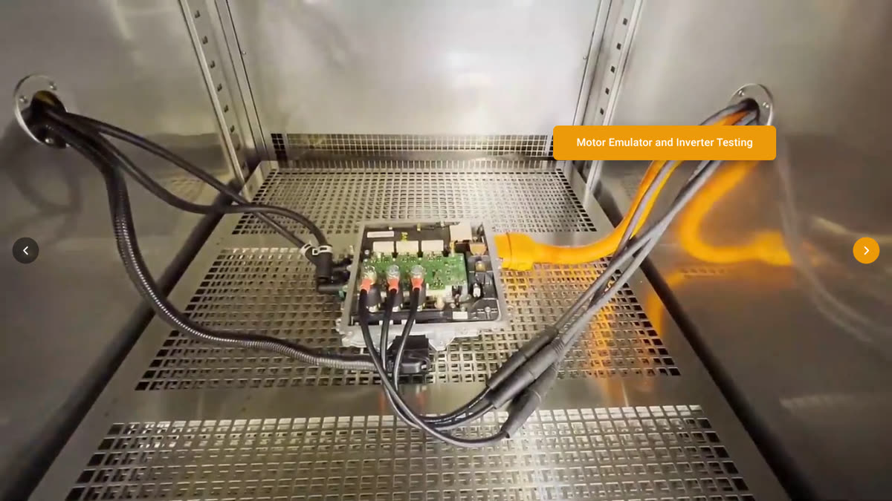
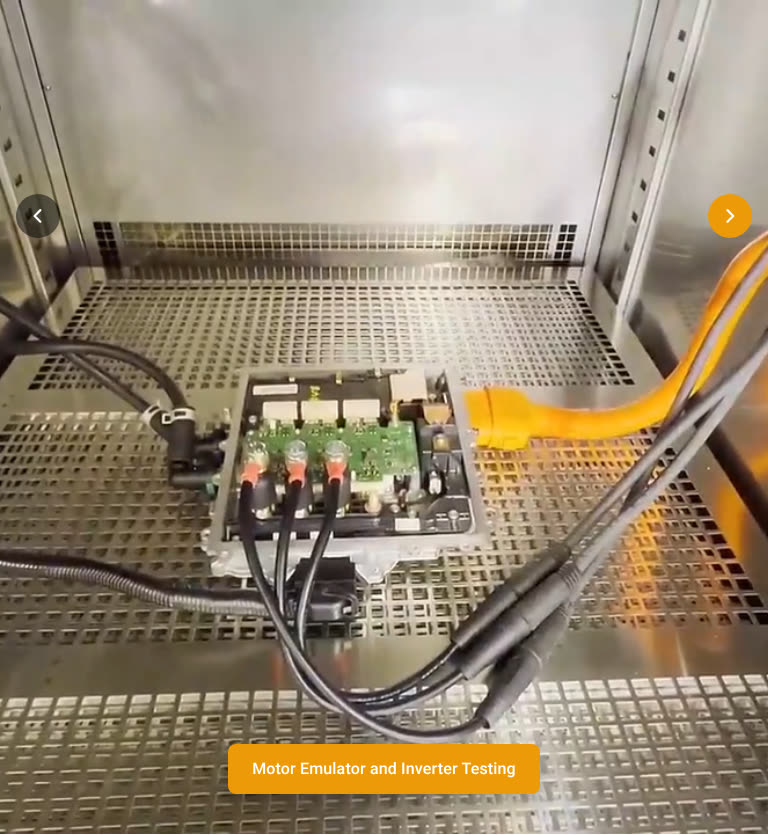
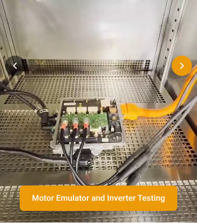

# Impedyme homepage header (hero slider)

One responsive header for desktop, tablet and mobile. It replaces the two Slider Revolution
sliders the homepage uses today (`desktop-header`, shown on desktop only, and `mobile-header`,
shown on tablet and mobile only).

| Desktop | Tablet | Mobile |
| --- | --- | --- |
|  |  |  |
|  |  |  |

## What it does

**Slide 1: product video**
- The header video plays (6 s, no loop).
- At **3 s**: the headline and the **Request Live Demo and Proposal** button come in from left to right.
  In the solutions table, the two vertical lines come down from the top, and the horizontal
  line and the six titles come in from left to right.
- About **1 s before the video ends**, the Simulink blocksets image comes in from right to left.
- The slide holds for 3 s, then moves to slide 2 (about 9 s in total, like the current site).

**Slide 2: inverter testing video**
- The video fills the slide and the **Motor Emulator and Inverter Testing** button is on top of it
  for the whole video. When the video ends, the header goes back to slide 1 and starts again.

Both buttons use `#ed9a09` with white text. On hover, a radial gradient (yellow centre to
orange-red edge) fades in, like the current site.

**Layout by screen size** (based on the width of the header itself):

| Width | Layout |
| --- | --- |
| 1024 px and wider (desktop, laptop, tablet in landscape) | Text on the left, racks in the middle, table top-right, image bottom-right. The header fits on one screen below the site's top bar. |
| 768 to 1023 px (tablet in portrait) | Video, then headline and button, then the table. |
| Below 768 px (mobile) | Video, then headline and button. **No table.** |
| Phone held sideways | Video and text side by side so everything fits on one screen. No table. |

**Other behaviour**
- Always full width: the header spans the whole browser window, edge to edge, even inside a
  boxed column (on impedyme.com, BeTheme adds 12 px side margins on desktop and 33 px side
  padding on mobile; the header breaks out of both).
- Arrows on both sides; swipe on touch screens; left and right arrow keys.
- The slideshow pauses while the mouse is on a link or button, so a slide never changes
  under a click. It continues about 1 s after the mouse leaves.
- If a phone blocks autoplay (for example an iPhone in Low Power Mode) or a video cannot load, the
  header shows a still image of the video instead and still runs the same animations.
- Videos pause when the header is scrolled out of view or the browser tab is hidden.
- Visitors who turn on "reduce motion" in their system settings get simple fades instead of movement.
- If JavaScript is blocked, the text still appears after 3 s and the image after 5 s.

## Install on impedyme.com (recommended: plugin)

The plugin includes the videos and images, so nothing needs to go to the Media Library.

1. In WordPress go to **Plugins > Add New > Upload Plugin**, choose
   [`wordpress/impedyme-hero.zip`](wordpress/impedyme-hero.zip), then **Install Now** and **Activate**.
2. Edit the homepage in BeBuilder. The first two sections hold the old sliders:
   - **Section with the `desktop-header` slider**: in its Column item, replace the Slider Revolution
     shortcode with `[impedyme_hero]`. Then open the section settings and **turn off "hide on tablet"
     and "hide on mobile"** (today this section is hidden on those devices). The section's width
     setting does not matter: the header stretches to the full window width by itself.
   - **Section with the `mobile-header` slider**: delete it, or hide it on all devices.
3. Save, clear any page cache, and check the homepage on a computer, a tablet and a phone.

If the plugin upload is refused because the file is too large (about 2.5 MB), unzip it and copy the
`impedyme-hero` folder to `wp-content/plugins/` with your host's file manager or SFTP, then activate it.

If Slider Revolution is not used on any other page after this, you can deactivate it so its
scripts stop loading on every page.

## Alternative: paste-in HTML

[`wordpress/impedyme-hero-snippet.html`](wordpress/impedyme-hero-snippet.html) is the same header as
one block of HTML for an Elementor **HTML** widget or a Gutenberg **Custom HTML** block.

Both videos and the Simulink image already point to the files on impedyme.com
(`2025/03/impedyme-heade.mp4`, `2025/07/header-inverter-testing.mp4`).

1. Upload the two still images from [`media/`](media/) in **Media > Add New**:
   `header-inverter-testing.jpg` (shown while the slide-2 video loads) and
   `impedyme-header-end.jpg` (shown on slide 1 when a phone blocks autoplay).
   They are optional: without them those moments show black.
2. Open the snippet and check that the two URLs containing `2026/11` match the uploaded images
   (copy each file's URL from the Media Library if they differ).
3. Paste the whole snippet into the widget or block.

## Changing text, links, colours or timing

Edit the files in [`src/`](src/), then run `python3 build.py` to rebuild the preview, the plugin
zip and the snippet. (On a live site you can also edit the same files inside
`wp-content/plugins/impedyme-hero/`.)

- **Text and links**: `src/impedyme-hero.html`.
- **Colours, fonts, sizes**: the variables at the top of `src/impedyme-hero.css`.
  `--imp-hero-offset` is the height of the site's top bar (70 px), used so the desktop header fits
  on one screen.
- **Timing of slide 1**: attributes on the first slide in `src/impedyme-hero.html`:
  `data-imp-content-at="3"` (seconds before text and table come in),
  `data-imp-end-before="1"` (image comes in this many seconds before the video ends),
  `data-imp-hold="3"` (seconds to wait after the video before slide 2).
  Speeds and delays of each element are at the end of `src/impedyme-hero.css`.

## Preview

Open `index.html` in a browser (double-click it, or run `python3 -m http.server` in this folder and
visit http://localhost:8000). Resize the window to see the tablet and mobile layouts.

## Files

| Path | Purpose |
| --- | --- |
| `src/` | The source: markup, styles, script. Edit these. |
| `media/` | Header video, inverter video (audio removed, nothing else changed), still images, Simulink image. |
| `index.html` | Local preview (generated). |
| `wordpress/impedyme-hero.zip` | WordPress plugin, shortcode `[impedyme_hero]` (generated). |
| `wordpress/impedyme-hero-snippet.html` | Paste-in version (generated). |
| `wordpress/plugin/impedyme-hero.php` | Plugin source. |
| `build.py` | Rebuilds the generated files. |

## Notes

- The Simulink blocksets image is only 320 × 187 px, so it looks soft on high-resolution screens.
  A version about 700 px wide would look sharper; replace `media/Impedyme-Simulink-Blockset.png`
  (or the image URL in the snippet) and rebuild.
- White text on `#ed9a09` has a contrast ratio of about 2.3:1, below the WCAG AA guideline of 4.5:1
  for text this size. The colours are kept as requested; a darker orange such as `#b45f00` would pass.

## How it was tested

Headless Chromium (Playwright), at 16 screen sizes from 320 × 568 to 2560 × 1440 including
landscape phones. Checked: no horizontal scrolling at any size; edge-to-edge width inside a copy
of the homepage's BeTheme column structure (also with a desktop scrollbar and an off-centre column); nothing overlaps the racks; the
full slide cycle and its timing; arrows, keyboard and swipe; hover pause; autoplay blocked; a
missing video; reduced motion; no JavaScript; pausing off-screen. An axe-core accessibility scan
found no issues. The plugin was rendered through PHP, and the snippet was run through WordPress's
own auto-paragraph filter; both gave the same layout as the preview inside aggressive theme CSS.
